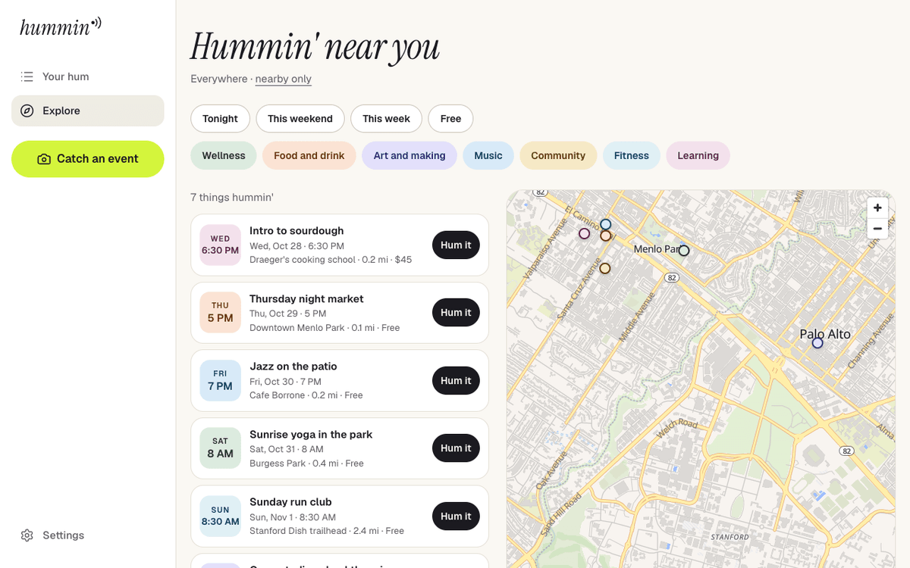

# Hummin'


Never miss what's hummin'. Save events from anywhere. Actually go.



Hummin' catches local events wherever you find them (a photo of a flyer, a screenshot of a story, a pasted link or text), turns them into a structured event with AI, asks you to confirm it, and then remembers it for you: your week, your recurring classes, and a map of what's hummin' nearby.

## Why this exists

Local events are scattered across Instagram stories, newsletters, group chats and cafe boards. You find them by luck, screenshot them, and forget. The recurring ones are the worst: the Thursday market, the Sunday run club, the first-Saturday potluck all live in your head until they don't. Calendar apps assume you'll type the details in. Nobody does.

Hummin' makes capture the fast part. Open, snap, check, saved, under fifteen seconds. The slow, careful part is the one that matters: **nothing is saved without the "Is this right?" step**, because a wrong date destroys trust faster than any missing feature.

## How it works

The design principle: **the model reads, code decides, you confirm.**

- **Capture from anything.** Camera or library photos (HEIC converted in the browser), up to ten screenshots at once, drag-and-drop or clipboard paste on desktop, a link, or pasted text. Images are rotated upright, resized to 1500px and stripped of metadata (including GPS) before anything else happens.
- **Links are imported, not guessed.** Luma, Eventbrite, Partiful and any page with schema.org `Event` JSON-LD are fetched server-side (SSRF-guarded, 2 MB and 8 s caps) and the structured data is used verbatim. No model call. Instagram can't be fetched behind its login wall, so the app says "screenshot it instead."
- **Everything else is read by Claude with a fixed schema.** The image and/or text go to the model with the capture time, your timezone and today's date, and a system prompt with the rules: only report what's visible, never invent a date, resolve "this Saturday" against when the photo was taken, return every event on the flyer, express repeats as an RFC 5545 RRULE. The response is constrained to a typed schema (title, local start and end, venue, address, price, host, category, recurrence, a confidence score, and the list of fields it could not find).
- **Two passes.** The fast model (`claude-haiku-4-5`) reads first. Any event under 0.6 confidence or with a malformed date is retried on the stronger model (`claude-sonnet-5`) and the better result wins. Every attempt is logged with model, latency and token counts.
- **You confirm.** Every field is editable. Fields the flyer didn't have are amber ("Not on the flyer"). A duplicate check (similar title within two hours of an event you already saved) runs before anything is written.
- **Private by default.** A saved event is yours alone. Tick "List it in Explore" and it appears for everyone nearby, geocoded onto the map. Flip it back any time.
- **Recurring events are first-class.** The next occurrence is computed from the RRULE in the event's own timezone, so a weekly class shows up under "This week" with the right date every week.

## Architecture

```
Phone / desktop browser
   │  photo · screenshots · link · text
   ▼
POST /api/extract ──► sharp: rotate, resize ≤1500px, strip EXIF ──► local disk / volume
   │
   ├─ URL?  fetch (SSRF guard) ─► schema.org Event JSON-LD found ─► draft events (no model)
   │                              └─ otherwise page text ─┐
   ▼                                                      ▼
Claude (fast) ── structured output (Zod schema) ──► confidence < 0.6 or bad date? ──► Claude (strong)
   │                                                                                   │
   └──────────────────────► normalise: RRULE check, local time → instant, price ◄──────┘
                                      │  logged to `captures`
                                      ▼
                            /catch/confirm  (sessionStorage draft, every field editable)
                                      │  "Hum it" → server action
                                      ▼
                     duplicate check → geocode venue (Nominatim) → events + saves rows
                                      │
                 ┌────────────────────┼─────────────────────┐
                 ▼                    ▼                     ▼
             /hum (tabs)        /e/[id] (actions)     /explore (filters + MapLibre map)
```

Key modules:

- `lib/ai/extract.ts` — the pipeline: link import → fast model → strong retry → normalised drafts, logged to `captures`
- `lib/ai/link-import.ts` — SSRF-guarded fetch and schema.org `Event` parsing
- `lib/ai/schema.ts`, `lib/ai/prompt.ts` — the output schema and the versioned system prompt
- `app/actions/events.ts` — server actions: save a draft, Hum it, goin', skip, delete, list/unlist
- `lib/events.ts` — Your hum lists, the Explore query, duplicate detection
- `lib/dates.ts` — timezone-correct next occurrence for recurring events (rrule in "floating" time)
- `lib/auth.ts`, `lib/session.ts` — Better Auth (Google + magic link) and the session helpers
- `instrumentation.ts` — applies Drizzle migrations when the production server starts

## Tech stack

- Next.js 16 (App Router, Cache Components) + TypeScript + Tailwind CSS v4
- Postgres + Drizzle ORM
- Better Auth: Google OAuth and email magic links, no passwords
- Anthropic API with structured outputs, validated with Zod
- sharp (server) and heic2any (browser) for images; date-fns-tz and rrule for time
- MapLibre GL with OpenFreeMap tiles; Nominatim for geocoding (no keys)
- Resend for email; Railway for hosting

## Quick start

You need Node.js 20+, Docker (for Postgres) and an [Anthropic API key](https://console.anthropic.com/).

```bash
# Postgres on port 5433 (the first run creates the container)
docker start hummin-pg 2>/dev/null || docker run -d --name hummin-pg \
  -e POSTGRES_USER=hummin -e POSTGRES_PASSWORD=hummin -e POSTGRES_DB=hummin \
  -p 5433:5432 -v hummin-pgdata:/var/lib/postgresql/data postgres:16-alpine

npm install
cp .env.example .env.local     # set DATABASE_URL, BETTER_AUTH_SECRET, ANTHROPIC_API_KEY
npm run db:migrate
npm run db:seed                # seven listed events near Menlo Park so Explore isn't empty
npm run dev                    # http://localhost:3000
```

Signing in locally needs no email provider: with `RESEND_API_KEY` unset, the sign-in screen shows an "Open the sign-in link" button (development only) and the link is also printed in the terminal.

To test the camera flow on a phone, open the "Network" address the dev server prints (same Wi-Fi). Auth follows the request host in development, so links and cookies work on both `localhost` and the phone's address.

## How to use it

1. **Catch.** Tap the lime camera button. Take a photo of a flyer, pick screenshots from your library, paste a link, or paste text. On desktop, drop files or paste an image from the clipboard.
2. **Check.** The reading screen hands off to "Is this right?". Fix anything the model misread; amber fields are the ones the flyer didn't have. Choose a repeat rule if it's a series. Tick "I'm goin'" or "List it in Explore" if you want.
3. **Hum it.** It lands in Your hum under This week, Upcoming or Recurring, with a toast.
4. **Go.** The event page has I'm goin', Add to calendar (Google Calendar link), Register (the host's own page) and "I can't make it". Owners can list, unlist or delete.
5. **Explore.** Filter by Tonight, This weekend, This week, Free and category; switch to the map; Hum events other people listed.

## Project layout

```
hummin/
├── app/
│   ├── (marketing)/          /, /privacy, /terms
│   ├── (auth)/               /login, /welcome (+ actions.ts: onboarding, profile)
│   ├── (app)/                /hum, /explore, /e/[id], /settings — inside AppShell
│   ├── (capture)/            /catch, /catch/confirm — AppShell without the bottom nav
│   ├── actions/events.ts     server actions for events and saves
│   └── api/                  auth handler, extract, files, health
├── components/
│   ├── app-shell/            bottom nav (< 1024px) and sidebar (≥ 1024px)
│   ├── auth/                 login and welcome forms
│   ├── catch/                capture screen, confirm screen, reading overlay, draft store
│   ├── events/               EventCard, DateTile, tags, category colours
│   ├── explore/              MapLibre map (worker served from /public)
│   └── ui/                   buttons, empty state, toast
├── lib/
│   ├── ai/                   prompt, schema, extraction pipeline, link import
│   ├── db/                   Drizzle schema (+ generated Better Auth tables), client
│   ├── auth.ts, auth-client.ts, session.ts, profile.ts
│   ├── events.ts, dates.ts, geocode.ts, storage.ts, rate-limit.ts, env.ts
│   └── email/                magic-link email (Resend, or terminal in dev)
├── drizzle/                  SQL migrations
├── scripts/seed.mts          demo listed events
├── instrumentation.ts        migrations on server start (production)
├── proxy.ts                  cookie check → /login for protected paths
├── SPEC.md · DESIGN.md · SCREENS.md · INFRA.md   the product, design and infra specs
└── .env.example
```

## API overview

- `POST /api/extract` — multipart: `images[]`, `text`, `url`, `timezone`, `capturedAt`. Returns draft events, image keys and a capture id. 30 per user per day, 5 per IP signed out.
- `GET  /api/files/:key` — serves an uploaded image to its owner, or to anyone when the event is listed or saved by the viewer.
- `GET  /api/health` — 200 when the app is up and the database answers.
- `/api/auth/*` — Better Auth (Google, magic link, session).

Mutations are Server Actions in `app/actions/events.ts`: `saveDraft`, `humEvent`, `setGoing`, `skipEvent`, `deleteEvent`, `setListed`. Every one re-checks the session and ownership on the server.

## Data model

`events` (one row per event, with `is_listed`, `rrule`, `timezone`, `lat`/`lng`, `ai_confidence`) · `saves` (user ↔ event with `saved | going | went | skipped`) · `captures` (every extraction attempt: model, latency, tokens, result or error) · `user_profiles` (area, radius, interests, timezone, reminder preferences) · `reminders` (scheduled, not yet sent) · Better Auth's `user`, `session`, `account`, `verification`.

`saves` is separate from `events` so one listed event can be saved by many people, and a captured event can later be listed without copying it.

## Deployment

The app runs on Railway: one service for the app, one Postgres, and a volume mounted at `/data` for uploaded images. Deploy from the project folder with `railway up`, or connect the GitHub repo for deploys on push.

Migrations run when the server starts (`instrumentation.ts`), so a deploy never serves against an out-of-date schema. Set `MIGRATE_ON_BOOT=0` to opt out.

| Variable | Purpose |
|---|---|
| `DATABASE_URL` | Postgres connection string |
| `BETTER_AUTH_SECRET` | session signing key (`openssl rand -base64 32`) |
| `APP_URL`, `BETTER_AUTH_URL` | the public origin, production only |
| `ANTHROPIC_API_KEY` | flyer reading |
| `AI_MODEL_FAST`, `AI_MODEL_STRONG`, `AI_DAILY_LIMIT_PER_USER` | optional overrides |
| `GOOGLE_CLIENT_ID`, `GOOGLE_CLIENT_SECRET` | "Continue with Google"; omit to hide the button |
| `RESEND_API_KEY`, `EMAIL_FROM` | magic-link email; omit locally for the dev shortcut |
| `UPLOAD_DIR` | where images are written (`/data/uploads` on Railway) |

Resend in test mode only delivers to the account owner's address; verify a sending domain to let anyone sign in by email. Google sign-in works for the consent screen's test users until the OAuth app is published.

## Tests

```bash
npm run lint        # ESLint (Next core-web-vitals + TypeScript rules)
npm run typecheck   # tsc, after `next typegen` or a build
npm run build       # also validates every route against the Cache Components prerender rules
```

CI (`.github/workflows/ci.yml`) runs lint and a production build on every push and pull request.

The flows are exercised end to end with headless Chrome via Playwright (sign-in by reading the magic link from the dev log, onboarding, Explore and the map, capture → confirm → save, goin', sign out). The extraction pipeline is checked with a rendered test flyer; a fixture set with expected JSON and an `eval:extract` script is the next step (see INFRA.md §8).

## Engineering notes

A few things this project learned the hard way:

- **Cache Components changes the rules.** Next.js 16 prerenders a static shell for every page, so anything that reads `params`, `searchParams`, cookies, headers or even `new Date()` must sit inside a `<Suspense>` boundary or be cached, or the build fails. Session reads live in small server components behind a boundary; `usePathname` in the shell is wrapped the same way; GET route handlers that must run per request call `connection()`.
- **Structured output schemas should be plain.** Regex `pattern` and `format` constraints don't belong in the schema the model is constrained to; the model fills a plain schema and strict checks (date shape, RRULE validity) happen in code afterwards.
- **MapLibre's web worker doesn't survive Turbopack.** The bundled worker URL breaks; the worker file is served from `/public` and set with `setWorkerUrl()`.
- **Multi-host auth in development.** Better Auth builds links from a configured base URL. For localhost and a phone on the same Wi-Fi to both work, development uses a request-derived base URL with an allow-list of private-network hosts, and Next's `allowedDevOrigins` includes the machine's LAN addresses (computed at config load).
- **Railway and config files.** The current Railway builder ignored the deploy settings in `railway.json`, so migrations never ran. Running them from `instrumentation.ts` is platform-independent and shows up in the start log.
- **Resend's test mode is strict.** It only delivers to the account owner's own email until a domain is verified, and the error is a 403 from the send call, not a bounce.
- **iCloud-synced folders corrupt build caches.** Desktop sync drops `LOG 2`-style duplicates into Turbopack's on-disk cache and crashes `next dev`; the dev cache is disabled and duplicate names are excluded from type-checking.

## Privacy

Private by default; sharing and listing are explicit. Uploaded images are stripped of metadata and served only to their owner unless the event is listed. The model only fills a schema; text inside a flyer is treated as content, never as instructions. No data is sold. "Download my data" and "Delete account" are on the roadmap before public launch.

## Roadmap

- Calendar files (`.ics` with RRULE) and share links with a "Hum this" CTA
- Email reminders (evening before and N hours before; re-check the source link before sending)
- Filters sheet (time of day, distance, price, "good for"), admin seeding page
- Cloudflare R2 for images, PostHog, PWA install, download/delete account
- Later: follows, vibe check-ins, weekly "What's hummin'" digest, host pages

The full product, design, screen and infrastructure specs are in [`SPEC.md`](SPEC.md), [`DESIGN.md`](DESIGN.md), [`SCREENS.md`](SCREENS.md) and [`INFRA.md`](INFRA.md).
